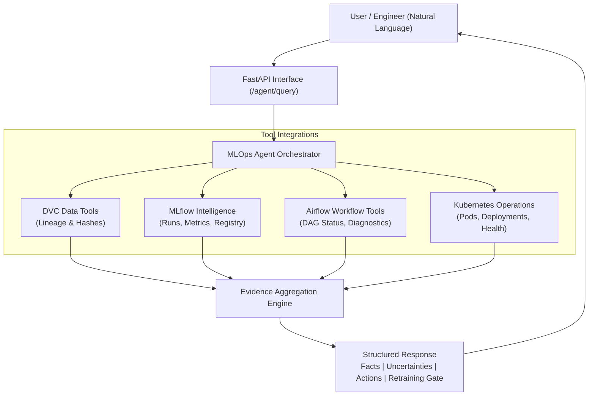
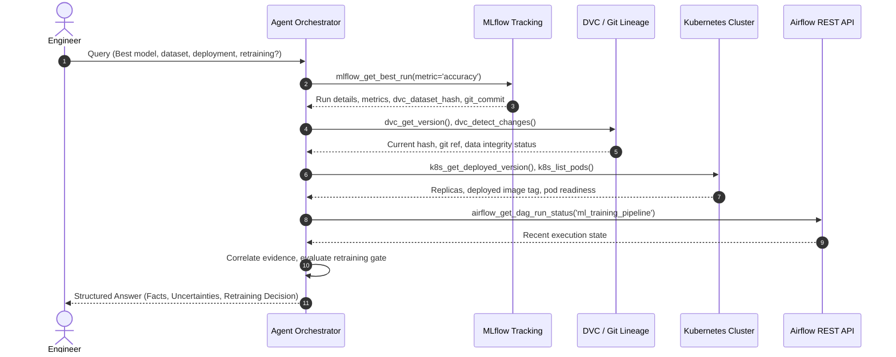
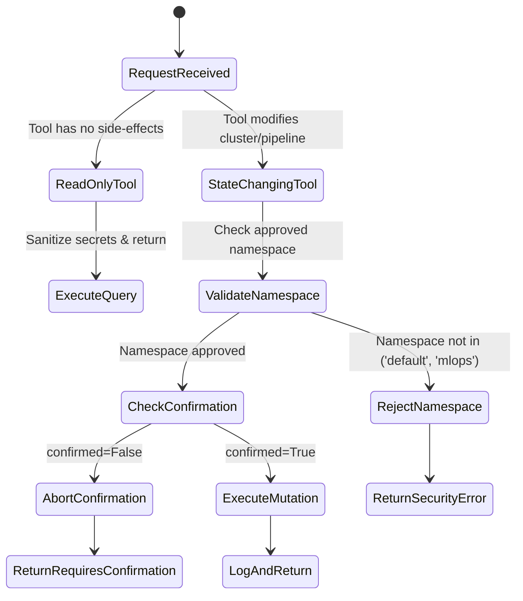
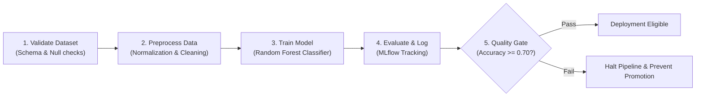

# MLOps AI Agent Architecture

Author: Rehan Akram (Roll No: 23i-0500, Section A)  
Course: MLOps & Production AI Engineering (Fall 2026)

---

## 1. System Overview

The MLOps AI Agent is an evidence-based operational assistant designed to automate machine learning lifecycle monitoring, diagnostic evaluation, workflow orchestration, and safe infrastructure operations. Unlike static chatbots, the agent interacts directly with external systems via structured tools, grounds every conclusion in recorded runtime evidence, and isolates uncertainties when services are unreachable.

---

## 2. Multi-Tool Interaction Flow

For complex operational queries such as the mandatory scenario:
> *"Find the best recent model, identify the dataset version used to train it, check the deployment status, and explain whether retraining is necessary."*

The orchestrator executes a coordinated multi-step investigation across four disparate technologies:

---

## 3. Provenance and Lineage Pipeline

Reproducibility and auditability are guaranteed through cryptographic hashes and version references linked across every phase:

1. **Dataset Versioning (DVC & Git)**:
   - Data files (`data/dataset.csv`) are hashed via MD5 and recorded in `data/dataset.csv.dvc`.
   - The `.dvc` pointer is committed to Git (`git rev-parse HEAD`), linking data state to code revision.
2. **Experiment Tracking (MLflow)**:
   - During training (`training/train.py`), the DVC MD5 hash and Git commit are injected as tracking tags (`dvc_dataset_hash`, `git_commit`).
   - Hyperparameters, evaluation metrics (`accuracy`, `f1_score`), and artifacts are recorded under unique `run_id`s.
3. **Container & Deployment Lineage**:
   - Model versions map to Docker image tags (`churn-inference-api:v1.2.0`).
   - The Kubernetes Deployment (`churn-inference-deployment`) mounts configuration matching the approved release.

---

## 4. Safety Guardrails & Permission Model

Operational safety is enforced at the orchestrator and tool level:

### Safety Controls
1. **No Invention / Anti-Hallucination Policy**: If an external service (Kubernetes cluster, Airflow server) is unreachable, the agent records a failure in the evidence log and explicitly populates the `uncertainties` list. It never fabricates operational statuses or metrics.
2. **Namespace Restrictions**: Kubernetes state mutations are restricted strictly to approved namespaces (`default`, `mlops`). Operations targeting system namespaces (`kube-system`, `ingress-nginx`) are rejected unconditionally.
3. **Explicit User Confirmation**: Operations that alter infrastructure state (`restart_deployment`, `scale_deployment`) abort with `requires_confirmation: True` unless an explicit confirmation flag is provided.
4. **Secret Sanitization**: Tool telemetry logs record tool names, categories, and execution durations in milliseconds while scrubbing authentication tokens, passwords, and sensitive keys.
5. **Retraining Gate**: Automatic retraining is blocked unless supported by verifiable evidence (such as local dataset drift or a failed model quality gate).

---

## 5. Training Pipeline Architecture (Airflow DAG)

The training pipeline in `dags/training_pipeline.py` implements five strictly ordered stages with retry behavior and quality gates:

If validation fails or model accuracy does not satisfy the threshold ($0.70$), execution halts immediately with an exception, preventing defective or degraded models from progressing to deployment.
